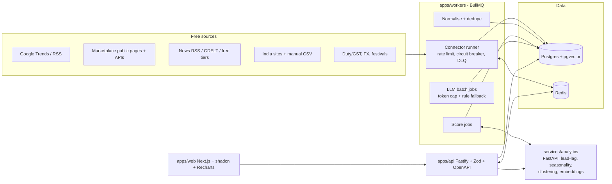
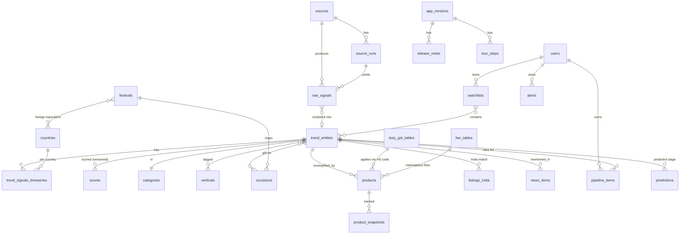

# TrendBridge — Pre-build Proposal (no code yet)

Status: awaiting approval. Next step after approval: Phase 0 only.

## (a) Understanding of the product (10 lines)

1. TrendBridge finds products and trends rising in foreign markets (US, UK, UAE, JP, KR, CN first) and checks how far India lags.
2. It answers: what is trending abroad, where is India on the adoption curve, and is it worth selling here.
3. Gifts is the primary vertical; RO / water purification (CLARYN) is the first deep-dive. Verticals are config, not code.
4. Everything is built on free sources, free tiers and open data (budget Rs 0). Scraped data is tagged lower-confidence.
5. Raw signals are ingested through pluggable connectors, kept separate from normalised data, then clustered into Trend Entities.
6. Each trend gets Momentum, Breadth, Sustainability and Commercial-proof scores, plus an India Lag estimate and Adoption Stage.
7. A weighted India Opportunity Score (0–100) has adjustable weights and always shows its inputs and confidence.
8. Every product gets a side-by-side import vs Indian-manufacture unit-economics model with a recommended route and break-even.
9. Workflow layer: watchlists, alerts, idea pipeline, prediction tracker (own hit rate), weekly report, grounded AI analyst chat.
10. Every release ships versioned notes, a What's New modal and a data-driven tour. Seed data is clearly labelled "Sample data".

## (b) Architecture

Key choices:

- **Fastify** over NestJS: lighter, first-class Zod/OpenAPI via `fastify-type-provider-zod`.
- **Drizzle** over Prisma: better pgvector support, SQL-first, fewer surprises with migrations.
- **Embeddings:** local `sentence-transformers` (multilingual MiniLM) in the Python service. Free, no API calls.
- **Cloud (later):** Vercel (web), Neon (Postgres + pgvector), Upstash (Redis), GitHub Actions cron for scheduled pulls.
- Everything runs in `docker compose` locally first.

## (c) ERD (core tables; all raw/normalised rows carry `source_id`, `fetched_at`, `confidence`)

Notes:

- `scores` stores `algorithm_version`, component values, weights used, confidence and an `inputs_json` snapshot, so every score is explainable and reproducible.
- `trend_signals_timeseries` is keyed by (trend, country, source, metric, date); `is_estimated` and `method` columns label estimates.
- `raw_signals` is append-only JSONB; normalisation never mutates it.
- `duty_gst_tables` and `fee_tables` are versioned (`effective_from`, `version`) and user-editable.
- Extra tables beyond your list: `product_reviews_summary`, `llm_cache` (hash → output, tokens), `llm_usage`, `rate_limit_usage`, `audit_log`, `bundles`, `unit_economics_scenarios`, `vertical_configs`, `user_seen_versions`, `backtest_cases`.

## (d) Connector list, cost and legal notes

All cost Rs 0. "Conf" = default reliability score.

| #   | Source                                                                           | Method                                                    | Free limit / cost                                           | Legal / terms note                                                                                                                                               | Conf                    | Phase |
| --- | -------------------------------------------------------------------------------- | --------------------------------------------------------- | ----------------------------------------------------------- | ---------------------------------------------------------------------------------------------------------------------------------------------------------------- | ----------------------- | ----- |
| 1   | Google Trends                                                                    | `google-trends-api` / pytrends (unofficial)               | Free, undocumented limits, 429s                             | Unofficial; ToS grey. Cache 24h+, 1 req / few sec, backoff, manual CSV fallback                                                                                  | Med                     | 1     |
| 2   | Google Trends RSS (daily)                                                        | RSS                                                       | Free                                                        | Public feed                                                                                                                                                      | Med                     | 1     |
| 3   | Wikipedia Pageviews                                                              | Official REST                                             | Free, generous                                              | Open, attribute                                                                                                                                                  | High                    | 2     |
| 4   | YouTube Data API v3                                                              | Official                                                  | 10,000 units/day (search = 100 units)                       | Needs free key; fixture mode without                                                                                                                             | High                    | 2     |
| 5   | Reddit                                                                           | Official API                                              | Free tier, low rate                                         | Needs app registration; follow API terms (commercial use limits matter for SaaS later)                                                                           | Med                     | 3     |
| 6   | Amazon Best Sellers / New Releases / Movers (US, UK, DE, AE, AU, JP)             | Polite public-page fetch                                  | Free                                                        | **Amazon ToS prohibits scraping.** Risk is yours; see risks. Default: manual CSV import + very low-frequency, cached fetch behind a feature flag, off by default | Low                     | 1     |
| 7   | eBay                                                                             | Public Browse API free tier (key)                         | Free quota                                                  | Official API preferred over page scraping                                                                                                                        | Med                     | 3     |
| 8   | Etsy                                                                             | Open API v3                                               | Free, key needs approval                                    | Official; gifts-critical. Approval may take days; fixture mode meanwhile                                                                                         | High                    | 3     |
| 9   | Walmart / Target bestseller pages                                                | Public pages                                              | Free                                                        | Scraping terms apply; manual import first                                                                                                                        | Low                     | later |
| 10  | AliExpress / Temu / Alibaba                                                      | Public pages                                              | Free                                                        | Anti-bot heavy; will NOT bypass. Manual import only                                                                                                              | Low                     | later |
| 11  | Kickstarter / Indiegogo                                                          | Public pages                                              | Free                                                        | Check robots.txt; early signal only                                                                                                                              | Low                     | 3     |
| 12  | Product Hunt                                                                     | Official GraphQL API                                      | Free, token                                                 | Non-commercial default; check terms for SaaS                                                                                                                     | Med                     | 3     |
| 13  | Pinterest Trends / TikTok Creative Center                                        | **Manual export only**                                    | Free                                                        | No public API; scraping is fragile and against terms. Import template provided                                                                                   | Med                     | 3     |
| 14  | Google News RSS                                                                  | RSS                                                       | Free                                                        | Store headline/source/date/URL only                                                                                                                              | Med                     | 1     |
| 15  | GDELT                                                                            | Official free API                                         | Free                                                        | Open                                                                                                                                                             | Med                     | 2     |
| 16  | GNews / NewsData.io / NewsAPI                                                    | Free-tier APIs                                            | ~100 req/day each; NewsAPI free is dev-only (no commercial) | Prefer GNews/NewsData; skip NewsAPI for production                                                                                                               | Med                     | 2     |
| 17  | Trade press / D2C RSS (Inc42, YourStory, Entrackr, ET Retail, Retail Dive, etc.) | RSS                                                       | Free                                                        | Headline + LLM summary only                                                                                                                                      | Med                     | 1     |
| 18  | Amazon.in / Flipkart / Meesho / Nykaa / FirstCry bestsellers                     | Manual CSV first, polite fetch optional                   | Free                                                        | Same ToS caveat as Amazon US; Flipkart/Meesho are JS-heavy and anti-bot. Manual import is the reliable path                                                      | Low                     | 2     |
| 19  | Instagram India hashtags                                                         | Manual input only                                         | Free                                                        | No legal automated access                                                                                                                                        | Manual                  | 3     |
| 20  | Customs duty / GST (CBIC, ICEGATE)                                               | Manual-seeded tables from public notifications, versioned | Free                                                        | Public; editable; must be verified by you or a CHA                                                                                                               | High after verification | 4     |
| 21  | FX                                                                               | ECB/Frankfurter API (no key)                              | Free                                                        | Open. (exchangerate.host free tier now needs a key; Frankfurter preferred)                                                                                       | High                    | 0     |
| 22  | BIS / WPC / CDSCO rules                                                          | Curated static rules JSON                                 | Free                                                        | Informational only                                                                                                                                               | Med                     | 4     |
| 23  | Festival calendar                                                                | Static JSON shipped with app                              | Free                                                        | Hand-maintained, 2026–2028                                                                                                                                       | High                    | 0     |
| 24  | Manual CSV/JSON import                                                           | Upload + Zod validation + templates                       | Free                                                        | n/a                                                                                                                                                              | User-set                | 1     |

Free-tier usage meter in the Source Registry reads from `rate_limit_usage` (calls used / limit / window).

## (e) Scoring formulas (v1, all weights editable in the UI; every output stored with inputs)

Notation: each component is normalised to 0–100. `confidence` ∈ [0,1].

**Seasonality-adjusted series.** STL decomposition (period 52 weeks) on weekly interest; work on the trend + remainder, not the raw series. Needs ≥ 2 years; otherwise fall back to year-over-year comparison and lower confidence.

**Momentum (0–100).**
`g_w = (mean(last w days) − mean(prior w days)) / max(mean(prior w days), ε)` for w ∈ {7, 30, 90, 365}.
`Momentum = 100 · squash( 0.15·g7 + 0.30·g30 + 0.35·g90 + 0.20·g365 )`, squash = logistic with midpoint 0 and scale tuned on back-test. Computed on the seasonality-adjusted series, per country, then averaged weighted by source-country priority.

**Breadth (0–100).**
`Breadth = 100 · ( 0.6 · C/Cmax + 0.4 · S/Smax )` where C = countries with momentum > threshold, S = distinct independent sources confirming (search, marketplace, news, social count as separate source types). Max 6 countries, 4 source types.

**Sustainability (0–100).**
`Sustainability = 100 · ( 0.4·(1 − spikiness) + 0.3·persistence + 0.3·slope_stability )`

- spikiness = share of total interest in the top 10% of days (fad indicator)
- persistence = fraction of last 12 weeks above the trend's 52-week median
- slope_stability = 1 − normalised variance of rolling 8-week slope

**Commercial proof (0–100), estimates only.**
`Proof = 100 · ( 0.35·rank_score + 0.30·review_velocity + 0.20·seller_count_score + 0.15·price_stability )`

- rank_score from best-seller rank percentile within category (lower rank = higher score)
- review_velocity = new reviews per month from snapshots (needs ≥ 2 snapshots)
- Always labelled "proxy, not sales". Sales-per-month displayed only as a range with the method shown, never a point figure.

**India Lag (months) and Adoption Stage.**

- For each backtest case and source country, compute cross-correlation of (differenced, seasonality-adjusted) foreign vs India search curves over lags 0–36 months; lag = argmax with correlation ≥ 0.4. Category lag = median across cases with bootstrap interval.
- For a live trend: `lag_remaining = category_lag − (months since India curve crossed its own early-signal threshold)`.
- **Stage** by India interest index relative to the trend's own foreign peak: `<2%` Not Yet Visible; `2–8%` Early Signal; `8–25%` Emerging; `25–60%` Growing; `60–100%` Mainstream; `>100% and flattening` Saturated. Marketplace competition count refines the stage.
- Caveat: Google Trends is relative within a query, so India vs foreign is compared via same-term shared-baseline queries (compare mode), not raw numbers.

**India Opportunity Score (0–100).**
`Opp = Σ wᵢ·cᵢ`, default weights:

| Component                                                     | Weight |
| ------------------------------------------------------------- | ------ |
| Foreign momentum (blend of Momentum, Breadth, Sustainability) | 0.22   |
| Lag window remaining                                          | 0.18   |
| Indian competition gap (inverse listing density)              | 0.14   |
| Price fit (INR affordability for target band)                 | 0.10   |
| Margin potential (best of import / manufacture)               | 0.14   |
| Regulatory ease                                               | 0.07   |
| Logistics feasibility                                         | 0.05   |
| Seasonality alignment (festival window reachable)             | 0.10   |

Sliders renormalise weights to sum to 1. **Gating:** if any of regulatory ease or margin < 15, Opp is capped at 49 and flagged.

**Confidence (0–1).**
`conf = 0.30·data_coverage + 0.25·source_reliability_avg + 0.20·history_length_factor + 0.15·source_agreement + 0.10·freshness`
Estimated, scraped or sample data each cap their contribution. Shown as High ≥ 0.7, Medium 0.4–0.7, Low < 0.4. Sample data is always "Sample" regardless.

**Unit economics.**

- Import: `landed = FOB·fx + freight + FOB·fx·duty% + (CIF + duty)·IGST% + clearance` ; `net_margin = price − landed − fees − packaging − returns·rate − ads`; `break_even_units = fixed_costs / unit_contribution`.
- Manufacture: `BOM + conversion + tooling/MOQ amortised + packaging + logistics` plus the same marketplace costs; hub, MOQ and lead time come from editable reference tables.
- Recommended route by risk-adjusted contribution, MOQ working capital and lead time vs festival deadline; hybrid when import now / localise later wins.

**Prediction tracker.** Store predicted stage + date horizon; at horizon compare to observed stage; report hit rate and calibration by confidence band.

## (f) Risks

1. **"Rs 0" vs LLM.** The Claude API is not free. Plan: LLM calls are optional, capped by a daily token cap, applied only to the top-N items, cached by content hash; rule-based fallback otherwise. Need your call on whether any API spend is acceptable (see questions).
2. **Scraping legality.** Amazon, Flipkart, Walmart and Temu prohibit automated scraping; anti-bot systems will block polite fetchers anyway. I will not bypass logins, CAPTCHAs or anti-bot. Defaults: manual CSV import is the primary marketplace path; page fetch is a feature-flagged, off-by-default connector you enable at your own risk. Also a SaaS-time liability.
3. **Google Trends is unofficial.** It can break or throttle at any time. Mitigation: heavy cache, backoff, circuit breaker, manual CSV export fallback. Trends values are relative, which complicates India vs foreign comparison.
4. **Sales numbers are not obtainable for free.** Everything is proxy-based and labelled. Do not treat Opp as demand forecasts.
5. **Lag model needs history.** Backtest cases (air fryer, smart ring, Stanley tumbler, mushroom coffee, etc.) are few (aim 25–40); lag estimates will be wide with low confidence initially. Prediction tracker is how it earns trust.
6. **Seed data is synthetic.** Clearly labelled; real-data pipelines must overwrite and never mix silently.
7. **Free API terms.** Etsy approval delays, Reddit/Product Hunt non-commercial limits (matter for future SaaS), NewsAPI free is dev-only.
8. **Duty/GST/fee tables go stale.** Seeded from public notifications, flagged "verify with CHA/CA", versioned, editable. Not legal or tax advice. Trademark/design flags are informational only.
9. **Scope.** This is ~8 phases of work; Phase 0 alone is large. Python service and embeddings add ops weight. Mitigation: strict phase gating, mock mode everywhere.
10. **Cloud free tiers.** Neon/Upstash limits may bite with heavy time-series writes; keep to weekly granularity for long history, daily only for the last 90 days.

## (g) Questions and assumptions

Assumptions (proceed unless you object):

- Single user with email magic-link login, schema carries `user_id` everywhere (multi-user ready).
- Fastify + Drizzle + local embeddings, as above.
- Priority countries: US, UK, UAE, JP, KR, CN. Display INR with source currency shown.
- Marketplace page-fetch connectors ship **disabled by default**; manual CSV import is the primary route.
- Local Docker first; cloud guide in Phase 7.
- Seed: 30+ trends (gifts + RO), 2 years synthetic weekly series, labelled "Sample data".

Questions:

1. **LLM spend:** is a small Claude API budget acceptable (e.g. Rs 300–500/month with the token cap), or must it be strictly zero, running on rule-based summaries until you decide?
2. **Amazon/Flipkart fetching:** okay to default to manual import only (with the optional flagged fetcher), given the ToS risk?
3. **Do you want a Rs 0 hosted deployment early,** or purely local until Phase 7?
4. **Backtest cases:** I'll draft a list of ~30 past trends with approximate foreign and India timelines for you to correct. Okay to start from my knowledge and have you verify?
5. **Tour library:** driver.js (light, my default) fine?
6. **Auth:** email magic-link requires an SMTP sender; for local dev I'll log the link to console. Fine for Phase 0?
